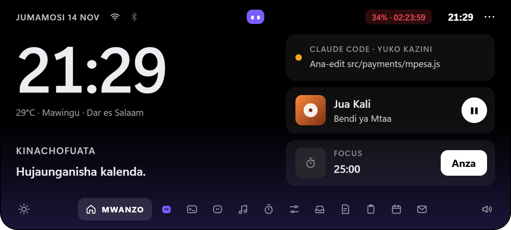

# Pip

**One island to Rule All Agents.** An open-source status island for Windows and macOS. A small notch at the top of your
screen shows what your AI coding agents (Claude Code and Codex) are doing, and opens on hover into a panel of tools.
The interface is in Tanzanian Swahili by default; English is in Settings.



MIT licence. Free for 7 days with everything open; after that the island and agent status stay free and the other tabs
need a one-time license of TSh 5,000 (mobile money or card, through EvPay). The license belongs to your Pip account
(Google or email), which also syncs your setup between devices. No telemetry.

**Download:** [pip.bang.co.tz](https://pip.bang.co.tz) · Windows 10 and 11 · macOS (Intel and Apple silicon) · version 1.0.1

The installer is not code-signed yet, so Windows SmartScreen warns: choose "More info", then "Run anyway". The Mac
app is signed ad hoc but not notarized by Apple: the first time, open System Settings → Privacy & Security and press
**Open Anyway**. When updating, quit the old Pip first. When a
newer Pip is uploaded to pip.bang.co.tz, Pip shows a notification (click it to download) and a dot on the `•••` menu →
**Updates**. It looks at start and every six hours; switch it off in Settings → General. Each build carries a stamp
(`tools/stamp.js`), so an installer rebuilt under the same version number is offered too.

## Features

| Feature | State |
| --- | --- |
| Claude Code live status, activity feed, history | Tested end to end on Windows (smoke test with the real hook scripts) |
| Allow / Deny a permission request, right in the folded island | Tested end to end on Windows |
| Answer Claude Code from the island (background Stop hook, needs Node.js) | Tested end to end on Windows |
| Usage chip for the 5-hour limit with a live countdown (status line, needs Node.js) | Tested end to end on Windows |
| Agents told to answer in Tanzanian Swahili at session start | Tested against the hub; not seen in a real session |
| Codex live status (hooks via `curl.exe`) | Hook install tested; not run against a real Codex |
| Chat with Pip right in the island (explain / check / translate what you copied, or ask about your screen), answered by your own Claude Code or Codex | Answer from the real Claude Code CLI tested on Windows (3.5 s); Codex not tried |
| Welcome in seven steps, redesigned Settings window with search, four Home layouts | Screenshots checked on Windows; clicked through in the smoke test |
| Lyrics you can scroll, a click on a line jumps the song there | Drawn and checked on Windows with sample lyrics; seeking not tried on a live song |
| A file arriving from the phone: progress in the island, confetti when it lands | Drawn on Windows; not yet tried with a real phone upload |
| An agent error turns Pip's eyes and the glow red in the folded island | Drawn on Windows |
| Phone as the music source: Windows becomes a Bluetooth speaker for a paired phone (no song name, so no lyrics); on a Mac, AirPlay from an iPhone shows the song and lyrics | Windows: connecting a Pixel tested; Mac AirPlay not yet tried |
| iPhone on a Mac: new messages (sender and first line) and incoming calls on the island, read on the Mac only (Messages and Contacts need Full Disk Access, the call alert Accessibility) | Not yet tried on a Mac |
| Music: now playing, cover art (fetched when missing), release year, controls, synced lyrics view | Tested on Windows with Media Player; the seek bar and fetched cover art not yet seen on a live song |
| Focus timer, Modes (Work, Study, Sleep, Game) and the focus guard | Tested on Windows |
| Calendar (day and month) and unread email count with Google sign-in | Tested end to end with a real Google account |
| File tray (drop in, drag out), phone transfer by QR code on any network: direct on the same Wi-Fi, otherwise through Pip's end-to-end encrypted relay | Same-Wi-Fi transfer tested on Windows from a second device; relay tested live (1 MB round trip, identical bytes) |
| Notes with tick circles, clipboard history, Wi-Fi and Bluetooth state, volume | Tested on Windows (radio switching not clicked) |
| Weather | Written; the owner saw an empty card, cause not found yet |
| Island brightness, size (80–140 %), transparency, Pip's colour and hat, hide tabs | Tested on Windows |
| Spotify device switching (your own client ID, PKCE) | Token refresh and device list tested with a fake server; login not run |
| Installer and uninstaller (plain NSIS, `build/pip.nsi`) | Built and opened on Windows |
| Optional Pip account: Google or email sign-in (a six-digit code from no-reply@bang.co.tz, no password), preferences / note / town / calendar link synced through pip.bang.co.tz (`server/pip-api.py`) | Server tested live (refuses bad tokens) and locally end to end; sync logic unit-tested; a real Google sign-in into an account not yet tried |
| **macOS build** (DMG for Intel and Apple silicon, built by GitHub Actions): the island sits over the camera notch with Pip's eyes at its left, Spotify and Music through AppleScript, volume, Wi-Fi and Bluetooth (switching Bluetooth through `blueutil`, installed with Homebrew), the focus guard (front app, and the open tab in Safari and Chromium browsers; Firefox by name only); every "PC" in the app reads "Mac" | Tested by the owner on a real Mac (November 2026): all features work |

## Run it

```
npm install
npm start           # Ctrl+Alt+Space toggles the island
npm test            # 38 Node tests, any OS
npm run dist:win    # on Windows: Pip.exe and the installer in dist/ (needs makensis on PATH)
npm run dist:mac    # on a Mac: dist/Pip-<version>-mac.dmg (GitHub Actions builds it on every push)
PIP_HUB_PORT=48699 npx electron --no-sandbox tools/smoke.js out/   # full smoke test, next to a running Pip
node tools/deploy-site.js [--site]                                 # publish pip.bang.co.tz (BANG DIGITAL's server)
```

## Coming from Peep

Pip used to be called **Peep**. The Pip installer removes Peep and takes its place: settings, Google and Spotify
logins, history, tray files and connected agents move over by themselves. Peep's hook entries keep working until Pip
replaces them with its own on its first start.

## How it works

- `src/main/hooks-hub.js`: an HTTP server on `127.0.0.1:48611` guarded by a random token. Agents post hook events to
  it. A permission request is held open until you click Allow or Deny, or answer in the terminal.
- `src/main/hook-install.js`: adds and removes Pip's entries in `~/.claude/settings.json` and `~/.codex/hooks.json`.
  It touches only its own entries (and Peep's, from before the rename), keeps a one-time `.pip-backup`, never replaces
  a status line you already have, and refuses to write a file it cannot parse.
- `src/hooks/pip-reply.cjs`: a background Stop hook (`asyncRewake`). It waits for an answer typed in the island and
  exits with code 2 to wake Claude with it.
- `src/hooks/pip-status.cjs`: a status line that forwards Claude Code's usage figures to the island.
- `src/helpers/win-helper.ps1`: one hidden PowerShell for the media session, volume, front window and radios, started
  with `-ExecutionPolicy Bypass` for that one process because Windows blocks unsigned scripts by default.
- `src/main/share.js`, `firewall.js`: phone transfer on your own network behind a random link (plain HTTP, one hour),
  and Pip's own Windows Firewall rule, added only after you approve it.
- `src/main/relay.js`: the same transfer across networks. Files are sealed with AES-256-GCM before they leave the
  device; the key travels only in the link's `#fragment`, so pip.bang.co.tz stores bytes it cannot read, for one hour.
- `src/main/mac-helper.js`: the macOS counterpart of the PowerShell helper (AppleScript/JXA, `networksetup`, `blueutil`).
- `src/main/google.js`: optional Google sign-in (PKCE, loopback), read-only calendar and the unread count only.
- `src/locales/sw.json`: every interface text, English to Swahili. A test fails if a text is missing.
- `site/`: the website at pip.bang.co.tz, with its privacy policy.

## What leaves your PC

Only what you switch on: the town you type (Open-Meteo), song title and artist (lrclib.net for lyrics, iTunes Search
for the year and cover art, Deezer for covers iTunes lacks), your private calendar link, a screenshot and question, or a chat with Pip, to the agent you
chose (through your own login), your Pip preferences, note, town and calendar link if you
sign in to a Pip account (stored on pip.bang.co.tz under a hash of your Google ID or email; with email sign-in your address is used only to send
the code), files sent to or from your phone across networks (end-to-end encrypted through pip.bang.co.tz, deleted after
an hour), Spotify if you connect it, Google if
you sign in (your calendar and only the number of unread emails, never who or what), and pip.bang.co.tz to see whether a
newer Pip is out (at start and every six hours, can be switched off), the license check (a one-way hash of this
device's ID, and your Pip account's session when signed in, at start and every six hours), and, when you buy Pip with
mobile money, the phone number you type, to EvPay through pip.bang.co.tz (a card is paid on EvPay's own page). Full policy: [pip.bang.co.tz/privacy](https://pip.bang.co.tz/privacy).

Code comments are in English so contributors outside Tanzania can read them.
