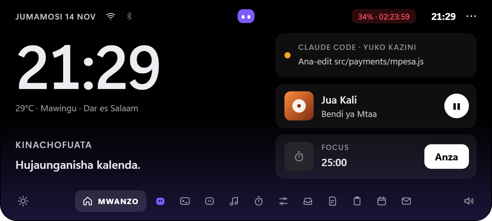

# Pip

**Agents wako wote Juu ya Screen.** Kisiwa kidogo juu ya screen yako ya Windows kinachokuonyesha ma-agent wako wa AI
(Claude Code na Codex) wanafanya nini, sasa hivi. Pip, kale ka-mascot, anakushtua agent akikuhitaji au akimaliza kazi.



Bure na open source (MIT). Huhitaji akaunti (akaunti ya Pip ni hiari, ina-sync mipangilio kati ya vifaa), hakuna malipo, hakuna telemetry. App nzima iko kwa Kiswahili cha mtaani
cha Tanzania; English ipo kwenye Settings. [English README](README.en.md)

**Pakua:** [pip.bang.co.tz](https://pip.bang.co.tz) · Windows 10 na 11 · toleo 0.7.0

Installer haina signature bado, kwa hiyo Windows SmartScreen itakuonya: bonyeza "More info" kisha "Run anyway".
Ndani ya Pip, menu ya `•••` → **Updates** inakuambia toleo jipya likitoka.

## Inafanya nini

**Ma-agent**
- **Live:** unaona Claude Code na Codex wanasoma, wana-edit au wana-run nini, pamoja na historia ya kazi.
- **Ruhusa kwenye kisiwa:** agent akiomba ruhusa (mfano `git push`), swali linakaa kwenye kisiwa kilichojikunja;
  bonyeza Ruhusu au Kataa bila kukifungua.
- **Mjibu hapa hapa:** Claude akimaliza au akiuliza swali, unamjibu kwenye kisiwa bila kurudi kwenye terminal.
- **Matumizi ya Claude:** asilimia ya limit ya masaa 5 na muda hadi irudi, pembeni ya saa.
- **Ma-agent wanajibu kwa Kiswahili** (unaweza kuzima).
- **Chat na Pip:** muulize Pip chochote hapa hapa kwenye kisiwa, eleza / sahihisha / tafsiri ulicho-copy, au muulize
  kuhusu screen yako. Anajibu kupitia Claude Code au Codex yako, bila kufungua browser.

**Kila siku**
- **Muziki:** wimbo unaopiga, picha ya album (inajazwa yenyewe ikikosekana), mwaka wa wimbo, play/pause/ruka,
  kusogeza wimbo, na **lyrics** zinazoenda na wimbo: zi-scroll, bonyeza mstari wimbo uende hapo.
- **Focus na Modes:** chora mstari wa dakika 1–60; modes za Kazi, Kusoma, Kulala na Game zenye timer, kuzuia YouTube
  na TikTok, na kurudisha kila kitu ukimaliza. **Mlinzi wa focus** anakuomba upumue kabla ya kufungua tovuti hizo.
- **Kalenda na Barua:** ingia na Google uone mchongo wa leo na mwezi, na idadi ya email ambazo hujasoma.
- **Mafaili:** dondosha mafaili kwenye kisiwa, yavute nje kwenda app nyingine, au yatume kati ya simu na PC kwa QR code
  (simu iwe kwenye Wi-Fi hiyo hiyo).
- **Noti** (mstari wa `[ ]` unakuwa kiduara cha kutiki), **ulizo-copy**, Wi-Fi na Bluetooth, sauti, hali ya hewa.
- **Kisiwa chako:** mwangaza wa background, ukubwa wa kisiwa (80–140%), uwazi, rangi na kofia ya Pip, kuficha tabs.

## Kuiwasha (kwa developers)

```
npm install
npm start           # kisiwa kinatokea juu ya screen; Ctrl+Alt+Space kinakifungua na kukifunga
npm test            # tests 35 za Node (OS yoyote)
npm run dist:win    # kwenye Windows: Pip.exe na installer ndani ya dist/ (inahitaji makensis kwenye PATH)
npm run dist:mac    # kwenye Mac: dist/Pip-<version>-mac.dmg (GitHub Actions inaitengeneza kila push)
PIP_HUB_PORT=48699 npx electron --no-sandbox tools/smoke.js out/   # smoke test kamili, pembeni ya Pip inayo-run
```

Kwenye Pip fungua **Settings → Ma-agent** kisha unganisha Claude Code au Codex. Codex itakuomba uzikubali hooks mpya
(andika `/hooks` ndani ya Codex). Kujibu kutoka kwenye kisiwa na asilimia ya matumizi vinahitaji Node.js kwenye PC.
Ukiwa tayari una status line yako kwenye Claude Code, Pip haiigusi.

## Kimejaribiwa mpaka wapi

Kwenye Windows 11 halisi: installer (kufunguka), jina na icon ya Pip, muziki (wimbo, picha, mwaka, lyrics), hali ya Wi-Fi na Bluetooth,
mlinzi wa focus, Google sign-in (kalenda na idadi ya email), kushiriki na simu kwenye Wi-Fi moja, na smoke test kamili
ya agent (session, ruhusa, kujibu, status line). Toleo la Mac (DMG) limejaribiwa na mwenye project; Wi-Fi, Bluetooth na mlinzi wa focus kwenye Mac bado hazijajaribiwa. Hakijajaribiwa bado: Codex halisi, kuingia Spotify, kubadilisha
Wi-Fi/Bluetooth kwa kubonyeza, kusogeza wimbo kwa bar, Pip agent kufungua chat, na hali ya hewa (card ilionekana tupu).

## Ukiwa unatoka kwenye Peep

Pip zamani iliitwa **Peep**. Installer ya Pip inaondoa Peep na kuchukua nafasi yake: settings, login za Google na
Spotify, historia, mafaili na ma-agent uliounganisha vinahamia Pip vyenyewe. Hooks za Peep zinaendelea kufanya kazi
mpaka Pip izibadilishe kwa zake mara ya kwanza inapowaka.

## Kinachotoka nje ya PC yako

Ni vile ulivyowasha tu: jina la mji linaenda Open-Meteo (hali ya hewa); jina la wimbo na msanii vinaenda lrclib.net
(lyrics) na iTunes Search (mwaka na picha ya wimbo; Deezer kwa picha ambazo iTunes haina); link ya kalenda inasomwa; swali la screen na chat ya Pip vinaenda kwa
agent uliyemchagua kupitia akaunti yako; mipangilio, noti, mji na link ya kalenda ukiingia kwenye akaunti ya Pip
(inahifadhiwa pip.bang.co.tz); Spotify ukiiunganisha;
Google ukiingia (kalenda yako na idadi tu ya email ambazo hujasoma, sio nani wala nini); na pip.bang.co.tz ukibonyeza
Updates. Hooks, ulivyo-copy, noti na mafaili vinabaki kwenye PC. Sera kamili: [pip.bang.co.tz/privacy](https://pip.bang.co.tz/privacy).

## Kutafsiri

Maneno yote yako kwenye `src/locales/sw.json` (English kushoto, Kiswahili kulia). Badilisha neno lolote usilolipenda;
test moja inahakikisha hakuna neno lililosahaulika. Lugha nyingine ni faili jipya la `<code>.json` kwenye folder hiyo.

## Kuitoa

Settings za Windows → Apps → Pip → Uninstall. Uninstaller inaondoa hooks za Pip kwenye Claude Code na Codex. Ukiitoa
kwa mkono, toa tiki za ma-agent kwenye Settings kwanza, au run `Pip.exe --remove-hooks`.

Pip ni project ya BANG DIGITAL LTD inayojitegemea. Haitumii code wala michoro ya app nyingine yoyote ya aina hii.
